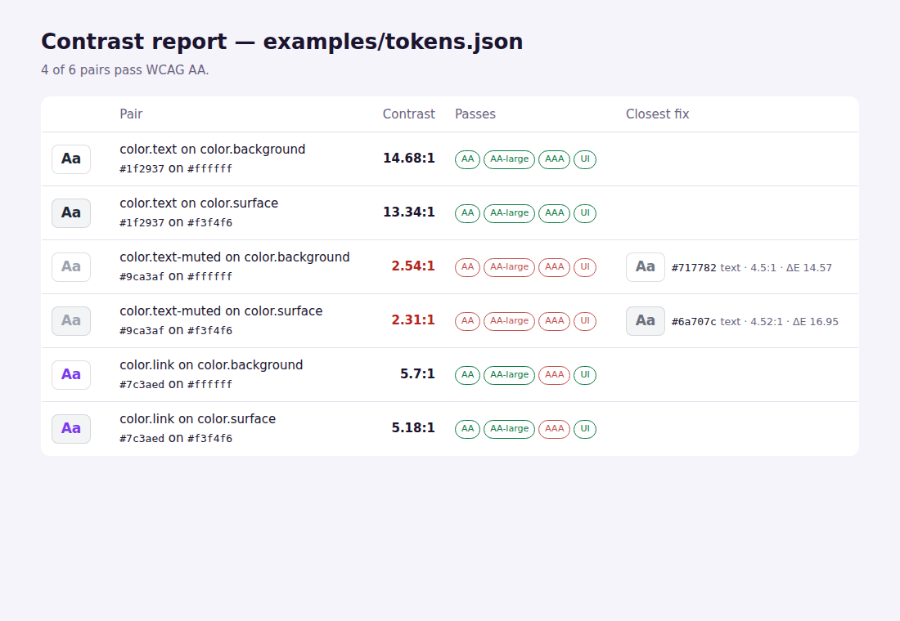

<p align="center">
  <picture>
    <source media="(prefers-color-scheme: dark)" srcset="assets/logo-dark.svg">
    
  </picture>
</p>

<p align="center">
  <a href="https://github.com/yagodejesus/contrast-doctor/actions/workflows/ci.yml"></a>
  <a href="https://www.npmjs.com/package/contrast-doctor"></a>
  
  <a href="LICENSE"></a>
</p>

**Find low-contrast colors in your CSS and design tokens — and get the closest color that passes WCAG, in the same hue.**

> 🇧🇷 *Encontra cores com contraste insuficiente no seu CSS e nos seus design tokens e sugere a cor acessível mais próxima, mantendo o tom da marca. Também aponta cores de status que pessoas daltônicas não conseguem diferenciar.*

Contrast checkers tell you `#a78bfa` on white fails. Then you're left nudging a slider until it passes, and the brand purple turns into some other purple. `contrast-doctor` searches in **OKLCH** — a perceptual color space — for the smallest lightness change that reaches the target, keeping hue and as much chroma as the screen can show.

```bash
$ npx contrast-doctor fix "#a78bfa" "#ffffff"
#8164cf  (4.51:1, darker, ΔE 12.66)

$ npx contrast-doctor audit styles.css
✓ .button (line 5)  #ffffff on #4f46e5  6.29:1
✗ .hint (line 7)  #9ca3af on #ffffff  2.54:1
    → closest fix: text #717782 (4.5:1, ΔE 14.57)
✗ .badge (line 8)  #ffffff on #22c55e  2.28:1
    → closest fix: background #00893c (4.52:1, ΔE 17.66)

1/3 pairs pass WCAG AA
```

<p align="center"></p>

## What it does

- **Checks** any pair against every WCAG 2.2 requirement: AA and AAA for normal and large text, and 3:1 for UI components (1.4.11). Translucent colors are composited over the background first.
- **Fixes** low contrast with the closest passing color — darker or lighter, text or background, whichever changes less — and tells you how far it moved (ΔE in OKLab).
- **Audits CSS**, resolving `var(--custom-properties)`, ignoring comments and reporting the selector and line.
- **Audits design tokens**: flat JSON, nested objects, W3C `$value` and Style Dictionary `value`, with `{color.brand}` references. Text-like tokens (`text`, `fg`, `on-*`, `label`, `link`…) are checked against background-like ones (`bg`, `surface`, `canvas`, `card`…), or against the pairs you name.
- **Catches color-blindness problems** — `success` and `error` that look the same to someone with deuteranopia — by simulating protanopia, deuteranopia and tritanopia (Machado et al., 2009).
- **Reports** as terminal output, JSON, Markdown (great for PR comments) or a standalone HTML page with swatches.
- Parses `#hex`, `rgb()`, `hsl()`, `oklch()` and CSS named colors. **Zero dependencies**; runs in Node ≥ 20, browsers, Deno and Bun.

## Install

```bash
npm install --save-dev contrast-doctor
```

## CLI

```bash
contrast-doctor check "#777" "#fff"                  # ratio + AA / AA-large / AAA / UI
contrast-doctor fix "#22c55e" "#fff" --level AAA     # closest color for AAA
contrast-doctor fix "#fff" "#22c55e" --bg            # keep the text, change the background
contrast-doctor audit src/styles.css                 # exit code 1 when something fails
contrast-doctor audit tokens.json --pairs text:bg,muted:surface --html report.html
contrast-doctor audit tokens.json --markdown >> "$GITHUB_STEP_SUMMARY"
contrast-doctor confusions status-colors.json        # ✗ success ↔ error: ΔE 2.9 (deuteranopia)
contrast-doctor simulate "#43a047" "#e53935"
```

## API

```ts
import { contrastRatio, grade, fixContrast, auditCss, auditTokens, findConfusions, simulate } from "contrast-doctor";

contrastRatio("#767676", "#fff");           // 4.54
grade("#777", "#fff");                      // { ratio: 4.48, AA: false, "AA-large": true, AAA: false, UI: true, ... }

fixContrast("#8a8a8a", "#fff");             // { color: "#767676", ratio: 4.54, deltaE: 6.76, direction: "darker" }
fixContrast("#7c3aed", "#0b0b1a", { target: "AAA" });
fixContrast("#fff", "#22c55e", { adjust: "background" });

auditTokens(tokens, { level: "AA" });       // PairResult[] with pass/fail and suggestions
auditCss(css, { defaultBackground: "#fff" });
findConfusions({ success: "#43a047", error: "#e53935" });   // [{ a: "success", b: "error", deficiency: "deuteranopia", deltaE: 2.9 }]
simulate("#e53935", "deuteranopia");        // RGBA as seen with deuteranopia
```

Conversions are exported too: `parseColor`, `toHex`, `toOklch`, `fromOklch` (with gamut mapping), `toOklab`, `luminance`, `deltaE`.

## In CI

```yaml
- run: npx contrast-doctor audit src/tokens.json --markdown >> "$GITHUB_STEP_SUMMARY"
```

The command fails the job when a pair is below the level you choose, and the summary shows the suggested fix for each one.

## Why accessible contrast matters

Low contrast is the single most common accessibility failure on the web, and it affects far more than people with low vision: anyone reading a phone in the sun, older adults, people with cataracts. Many countries require WCAG AA for public and private websites — in Brazil, the Lei Brasileira de Inclusão (Lei 13.146/2015, art. 63) requires accessible websites.

## Limitations

- Contrast is WCAG 2.x. APCA (the candidate method for WCAG 3) is not implemented yet.
- The CSS audit reads each rule on its own: it doesn't compute the cascade, inheritance or the actual page background. Use `defaultBackground` for rules that only set `color`.
- Color-vision simulation is a model. It's very good at catching problems, but nothing replaces testing with real users.

## Development

```bash
git clone https://github.com/yagodejesus/contrast-doctor && cd contrast-doctor
npm install
npm test
```

## License

MIT © Yago de Jesus Martins
